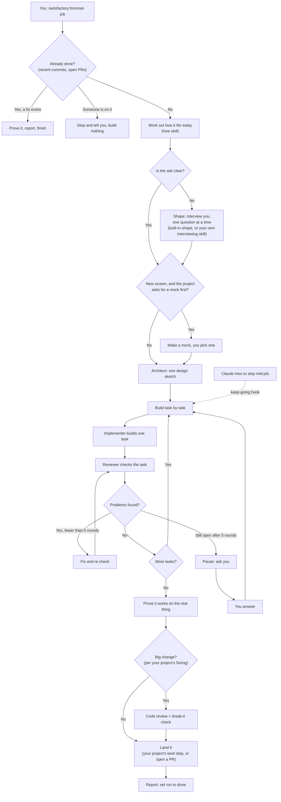
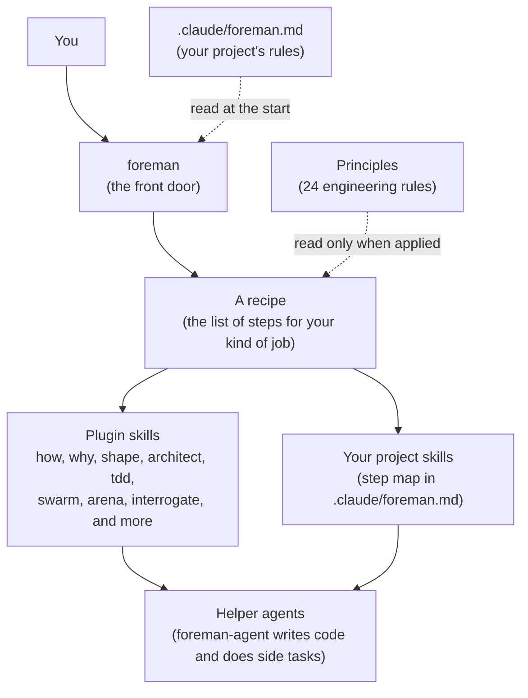
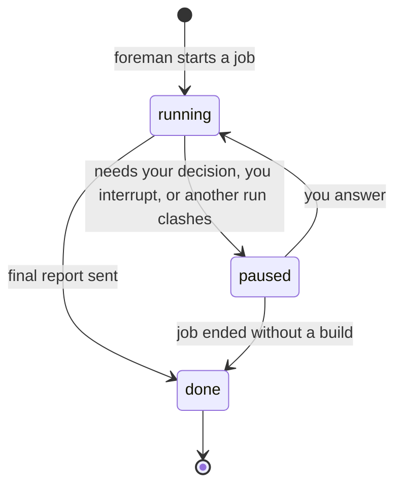

# autofactory guide

How to install autofactory, give it a job, and know what it is doing. No coding knowledge needed to follow this page.

## 1. What it is

autofactory is an agentic software factory for Claude Code. "Agentic" means Claude does the work in steps on its own, instead of answering one question at a time. The front door is a skill called **foreman**. You describe a job in plain words. Foreman picks a recipe (a fixed list of steps for that kind of job), runs it to done, and stops only for decisions that belong to a person.

It is built on [pstack](https://github.com/backnotprop/pstack) by Lauren Tan (poteto) and [superpowers](https://github.com/obra/superpowers) by Jesse Vincent.

## 2. Install

Type these two lines in Claude Code, then restart it.

```
/plugin marketplace add J3rey/autofactory
/plugin install autofactory@autofactory
```

## 3. Your first job

Type `/autofactory:foreman` and then the job in plain words.

```
/autofactory:foreman <job in plain words>
```

Three examples:

| Kind of job | What you type |
|---|---|
| Bug fix | `/autofactory:foreman The upload box on the settings page cuts off long file names. Fix it.` |
| Feature | `/autofactory:foreman Let customers download their invoices as PDF from the billing page.` |
| Hillclimb | `/autofactory:foreman Make the dashboard load at least 40% faster than it does now.` |

A hillclimb is a loop that tries one idea at a time, measures it, and keeps only what helps.

You do not need to say which recipe to use. Foreman matches the job to one.

## 4. What you'll see

**The opening line.** Every run starts with this message, followed by the goal in foreman's own words:

```
Foreman is on: Bug fix. I'll keep going until it's done or I need you.
```

If the goal is wrong, say so now.

**The session title.** If your Claude app can rename sessions, the title shows the state of the run.

| State | Title |
|---|---|
| Running | `Foreman · Bug fix: upload box styling` |
| Waiting for you | `⏸ Foreman · Bug fix: upload box styling (needs you)` |
| Finished | `✓ Foreman · Bug fix: upload box styling` |

**The progress band.** In the Claude desktop app and the terminal, a band sits above the prompt while a job runs. It looks like this:

```
Foreman · running · skill: foreman  [Hide]
██████████████░░░░░░░░░░░░░░░░ 5/12 · Reproduce the bug
```

- The first line shows the state (running, paused or done) and the skill in use. The color changes: cyan for running, yellow for paused, green for done.
- The second line is a progress bar over the recipe's steps, a count of finished steps, and the step in progress.
- Press **Hide** to tuck it away. Type `/foreman-progress` to bring it back.

<!-- screenshot: band + sidebar title, add after a real run -->

**Notifications.** If your app can send them, you get exactly two kinds. `Foreman needs you: <the question>` when it pauses. `Foreman done: <Recipe>: <job> (<where it landed>)` when it finishes. Nothing else.

## 5. When it stops for you

Foreman makes small, reversible choices itself and writes them down. It always stops and asks before:

- Force-pushing to a shared branch.
- Deploying, or pushing the production branch.
- Deleting data.
- Sending messages to customers.
- Writing to a production database.
- Spending real money beyond the free defaults.
- Making a product decision your users would notice.
- Adding a new dependency (a third-party package the project relies on).
- Interviewing you to shape an unclear feature.
- Anything your own project file adds (see section 9).

**How it asks.** It asks one plain question and puts its recommended answer first. The run is marked as paused, the title gets the `⏸` mark, and you get a notification.

**How you answer.** Reply in the chat. Pick the recommended answer or say something else. Foreman then marks the run as running again and carries on.

**Waiting is never a yes.** If you are away, foreman stays parked. It does not pick a default and push on. "No" is also a fine answer, and foreman will tell you honestly when it thinks an idea is not worth doing.

## 6. How a job runs

This is the path a build job takes. Not every step applies to every job. A step that does not apply is shown as skipped, with a one-line reason.



Two things worth knowing about this picture.

- **The keep-going loop.** Claude normally stops at the end of every reply. During a run, a small helper (a "Stop hook") sends it back to its task list instead, so a long job does not die half way. It lets go when the run is paused or done, after 25 pushes in a row, or when the notes are 6 hours old.
- **Pauses.** Any step can pause if it reaches an always-pause item from section 5. The picture shows the two most common ones. After your answer the run goes back to where it stopped.

## 7. The parts



- **Foreman** reads your job and your project file, then picks a recipe.
- **A recipe** is a list of steps. Foreman copies it onto the task list so you can follow along.
- **Skills** are small instruction sets for one kind of work. Each one can also be run directly as `/autofactory:<name>`. The main ones:
  - `how` explains a part of the code before it changes.
  - `why` finds the reasons behind code, from history and tickets.
  - `shape` turns a fuzzy idea into an agreed spec.
  - `architect` sketches the design before any code.
  - `tdd` writes a failing test first.
  - `swarm` runs several workers in parallel and gives back one report.
  - `arena` tries a task several ways and keeps the best parts.
  - `interrogate` tries to break a change, and keeps only findings it can prove.
  - `show-me-your-work` keeps a log of decisions for long or unattended runs.
  - `figure-it-out` designs a custom recipe when none fits.
  - `unslop` cuts robotic phrasing from writing. `bro` restates the last message in plain words.
- **Project skills** are the ones your own project already has (for example a code review skill). If the project file names them, foreman uses them for that step instead of its own.
- **Helper agents** are fresh Claude workers foreman hands single tasks to. Foreman reviews everything they produce.
- **Principles** are 24 short engineering rules. Foreman reads one only when it applies it, and names it in the reply.

## 8. Recipes

All recipes live in `skills/foreman/playbooks/`.

### Building

| Recipe | What it does | Example job |
|---|---|---|
| Feature | Designs and builds new or changed behavior. | "Add PDF download to the billing page." |
| Bug fix | Reproduces a bug, finds the real cause, fixes it, proves it. | "Long file names break the upload box." |
| Refactoring | Changes how code is organized without changing what it does. | "Split the checkout file into smaller parts." |
| Perf issue | Measures something slow, then fixes it against a baseline. | "The reports page takes 8 seconds to open." |
| User report | Takes a pasted customer complaint and turns it into a proven fix. | "A customer says: I can't reset my password." |
| Prototype | Builds a throwaway sketch to settle a design question cheaply. | "Mock up two layouts for the new inbox." |
| Visual parity | Matches a new screen to an approved mock, checked by image diff. | "Make the live page match the approved mock." |

### Finding out

| Recipe | What it does | Example job |
|---|---|---|
| Investigation | Read-only. Answers a question with sources. No code changes. | "How does sign-in work, and why was it built this way?" |
| Runtime forensics | Watches a live program to diagnose a leak or a stuck process. | "The app's memory keeps growing. Why?" |
| Trace forensics | Reads a captured profile or snapshot you hand over, and diagnoses it. | "Here is a performance trace. What is slow?" |
| Eval | Tests whether a change to a skill or prompt really improves behavior. | "Does the new prompt beat the old one?" |

### Numbers

| Recipe | What it does | Example job |
|---|---|---|
| Hillclimb | Loops: try one idea, measure, keep or undo, until a target is hit. | "Cut page load time by 40%." |

### Big jobs

| Recipe | What it does | Example job |
|---|---|---|
| Autonomous run | Drives one long task to a checkable finish line without stopping. | "Keep going until all tests pass." |
| Orchestrate | Runs a multi-day program with many helpers and many PRs. | "Own this migration until it lands." |
| Multi-phase plan | Writes the plan for work that spans phases or several PRs. It does not build. | "Plan the move to the new payment provider." |

For a large or odd job that fits no recipe, foreman uses `figure-it-out` to design a custom one.

### Housekeeping

| Recipe | What it does | Example job |
|---|---|---|
| Opening a PR | Commits and opens a pull request (a request to merge). Runs at the end of every other recipe. | Happens by itself. |
| Session pickup | Resumes another session's unfinished work from its notes or branch. | "Pick up where the last session stopped." |
| Pause safely | Stops cleanly and leaves a checkpoint to resume from. | "Pause here, I'm going offline." |
| Worktree cleanup | Frees disk space by removing finished work folders. | "Clean up old worktrees." |
| Authoring a skill | Writes or edits a skill file. | "Add a skill for our release notes." |

## 9. Set up your project

Foreman works without any setup. A project file makes it fit your project. It is one file at `<your project>/.claude/foreman.md`, and foreman reads it at the start of every job. Delete any section you do not need. The full template is `skills/foreman/references/project-file-template.md`.

It has five sections:

1. **Step map.** Which of your own skills does each step. An entry here replaces the plugin's own version of that step.
2. **Sizing.** What counts as a big change. Big changes get a code review and a break-it check before landing.
3. **Proof.** What counts as proof that a change works, by kind of change.
4. **Always pause.** Extra things foreman must ask you about, added to the built-in list.
5. **Reproduce.** Where foreman may run and read things while chasing a bug.

A short example for a fictional app called Acme:

```markdown
# Foreman project file

## Step map

| Foreman step | Project skill |
|---|---|
| Shape | `grill-me` |
| start isolated work | `new-worktree-branch` |
| code review | `code-review` |
| land | `finalize-worktree` |

## Sizing

- Big: sign-in or permissions, anything touching payments, database changes, a new API route.
- Small: copy, styling, a fix inside one function, config bumps.

## Proof

| Change observable in | Proof |
|---|---|
| Screen | A screenshot of the fixed screen, taken on the running Acme app. |
| API route | A request and its response against the local Acme server. |
| Pure logic | A test that fails before the fix and passes after. |

## Always pause

- Applying a database migration.
- Spending on any paid third-party service.

## Reproduce

- Run: the local Acme dev server with a test account.
- Read: local files and the dev database. Never production data.
```

**Add `.claude/foreman/` to your `.gitignore`.** Foreman keeps its run notes there, and they should not be committed.

## 10. Run state

Foreman keeps one small hidden file, `.claude/foreman/run.json`, that says whether a job is **running**, **paused** or **done**. The keep-going helper and the progress band both read it. Foreman writes it as its very first action, and a hook writes it too when you type the command yourself. If a second job starts in the same folder while the first is active, foreman spots the clash, warns you in one sentence, recommends a separate worktree, and waits for your answer.



## 11. FAQ

**Does it push to production?**
No. Deploys and pushes to the production branch are on the always-pause list, so it asks first. By default it works on its own branch and opens a pull request for you to review. Your project file can change how landing works, and can add more things to pause on.

**Can I stop it?**
Yes. Just type a message. If you interrupt or redirect, foreman marks the run as paused first and then listens. You can also ask it to "pause safely" and it leaves a checkpoint a later session can resume from.

**What if two jobs run in one folder?**
Foreman flags a clash and stops to ask you, because two runs in one folder can stop each other from being kept going. Give each job its own worktree (a separate working copy of the project) and they will not collide.

**How do I use my own interviewing skill?**
Two ways. Name it in the job, for example "grill me on this feature" or "use my interview skill". Or set it once for the project by mapping `Shape` to that skill in the Step map of `.claude/foreman.md`. If the skill is not installed, foreman says so and falls back to the built-in `shape`.

**Where are its notes?**
In `.claude/foreman/` inside your project. That holds the run state, the task notes and the decision log. It is meant to stay out of git.

**Does the interview mean it will ask me lots of questions?**
Only for unclear features. A clear job skips it, and you can tell the interview to skip itself ("just start") at the first question.
